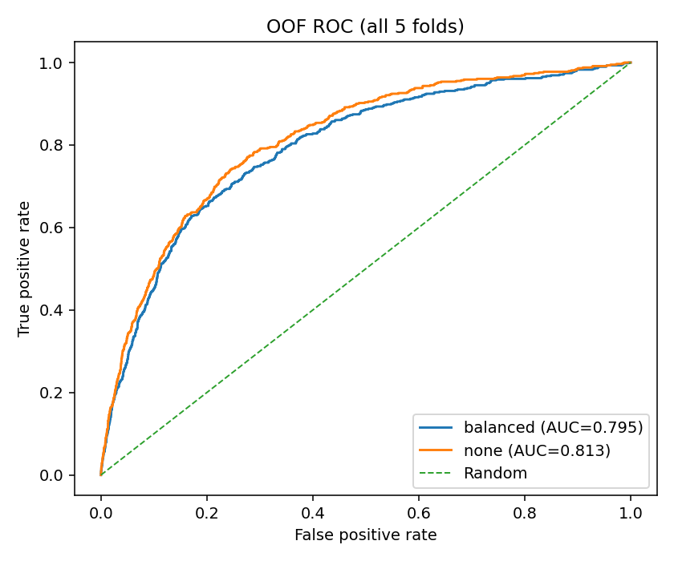

# SIIM-ISIC 2020: классификация меланомы

ДЗ1–ДЗ2 по курсу ML R&D: baseline, воспроизводимая валидация и эксперименты с метаданными.

## Задача и гипотеза

**Задача:** по дерматоскопическому изображению оценить вероятность меланомы (`target=1`, доброкачественное образование — `0`). Это бинарная классификация. Один объект и одно предсказание — одно изображение. На этапе inference baseline использует **только RGB-изображение**; несколько изображений одного пациента нельзя считать независимыми.      
      
**Гипотеза:** признаки замороженной ResNet-18, предобученной на ImageNet, позволяют отличать меланому от доброкачественных образований с помощью логистической регрессии. Ожидаем ROC-AUC > 0,5 и Average Precision выше доли положительного класса на валидации с непересекающимися пациентами. Это проверка переносимости признаков, **не** клинической пригодности модели.      

## Структура репозитория

```text
SIIM-ISIC-Melanoma-Classification/
├── README.md
├── requirements.txt
├── .gitignore
├── LICENSE
├── configs/
│   ├── baseline.yaml
│   └── kaggle.yaml
├── src/
│   ├── __init__.py
│   ├── common.py
│   ├── eda.py
│   ├── train.py
│   ├── pipeline.py
│   └── evaluate.py
├──reports/
|   └── figures/
│       ├── hard_errors.png
|       ├── roc_oof.png
|       └── pr_oof.png
└── tests/
    ├── __init__.py
    └── test_pipeline.py
```

## Данные и EDA

Источник: [соревнование SIIM-ISIC на Kaggle](https://www.kaggle.com/competitions/siim-isic-melanoma-classification/data), [описание датасета](https://doi.org/10.34970/2020-ds01). Используются только конкурсные `train.csv` и `jpeg/train/*.jpg`.
     
`src/eda.py` проверяет:
     
- уникальность `image_name`, наличие файлов, количество изображений на пациента, баланс классов и пропуски;    
- доступные метаданные: `age_approx`, `sex`, `anatom_site_general_challenge`, `diagnosis`, `benign_malignant`, включая долю меланом по категориям;     
- **точные побайтовые дубликаты** JPEG по SHA-256;    
- яркость (среднее в grayscale шкале 0–255), контраст (стандартное отклонение в grayscale шкале 0–255) и долю тёмных пикселей (яркость < 32 по шкале 0–255) **исходных** JPEG. Преобразования изображений в EDA не применяются.     
     
EDA сохраняет `clean_train.csv` и `excluded_images.csv`. Среди идентичных JPEG одного пациента с одинаковой меткой оставляет один; при разных пациентах или метках исключает всю группу (исходные файлы не удаляются). Хэши в отчёт не записываются. Также сохраняются таблицы и графики в `reports/eda/`. `lesion_id` и внешние метаданные не используются. `diagnosis` и `benign_malignant` рассматриваются только при анализе разметки: **в модель они не подаются**.    

### Результаты EDA

| Показатель | Значение |
|---|---:|
| Исходные изображения / пациенты | 33 126 / 2 056 |
| Меланомы до очистки | 584 (1,76%) |
| Пациенты с ≥1 меланомой | 428 (20,8%) |
| Точные дубликаты | 433 пары (866 файлов) |
| Исключено повторов | 433, из них 3 положительных |
| После очистки | 32 693 изображения, 581 меланома; 2 056 пациентов |
| Отсутствующие JPEG / JPEG без записи в CSV | 0 / 0 |

Во всех 433 парах точных дубликатов совпадают `patient_id` и `target`; оставлен один файл из каждой пары. В одной паре указаны разные локализации одного и того же изображения (`upper extremity` и `torso`) — пример несогласованности метаданных, не влияющий на image-only baseline.    

Пропуски: `sex` — 65, `age_approx` — 68, `anatom_site_general_challenge` — 527. У 27 124 изображений `diagnosis=unknown`; `diagnosis` и `benign_malignant` не используются как признаки из-за риска утечки целевой информации. Медиана числа изображений на пациента — 12, максимум — 115.   

Медианы характеристик **исходных** изображений (доброкачественные / меланома): яркость — **177,1 / 148,6**, контраст — **20,9 / 29,0** (шкала grayscale 0–255); доля тёмных пикселей — **0,004% / 0,204%**. Доля меланом также заметно отличается между разрешениями: 6000×4000 — **0,16%** (24 из 14 703), 2592×1936 — **10,53%** (71 из 674). Это может указывать на смещение, связанное с источником или условиями съёмки. Влияет ли оно на предсказания модели, по результатам EDA определить нельзя.       

Ограничения: сильный дисбаланс, пропуски метаданных, возможный шум разметки, различия в условиях съёмки. Доля меланом в датасете не равна распространённости заболевания в популяции. Числовые статистики изображений рассчитаны до удаления дублей; baseline обучается на очищенной от дублей выборке.     

## Baseline и протокол оценки

- **Признаки:** замороженная `ResNet-18` с весами ImageNet, вектор из 512 признаков. Preprocessing: resize короткой стороны до 256 → центральный crop 224×224 → нормализация ImageNet. Без аугментаций.     
- **Классификатор:** `StandardScaler` + `LogisticRegression`. Гиперпараметры (`C`, `solver`, `l1_ratio` (0 = L2), `max_iter`, `tol`, `class_weights`) заданы в YAML-конфиге; `random_state` берётся из `validation.seed`. Параметры `StandardScaler` рассчитываются только на обучающей части каждого фолда; там же обучается `LogisticRegression`.      
- **Валидация:** 5-fold `StratifiedGroupKFold`, `seed=42`, группировка по `patient_id`. Используется очищенный CSV из EDA; пересечения пациентов не допускаются.        
- **Дисбаланс:** два варианта на одинаковых признаках и фолдах — **B0:** `class_weight=None` (основной baseline), **B1:** `class_weight="balanced"` (контрольный эксперимент).       
- **Основная метрика:** ROC-AUC (как в соревновании); дополнительные — Average Precision (AP), Recall при FPR ≤5%, prevalence (доля положительного класса), матрица ошибок при пороге 0,5. Отчёт: значения по фолдам, среднее ± выборочное стандартное отклонение (`ddof=1`), общие OOF-метрики и ROC/PR-кривые. Std описывает разброс между фолдами, а не доверительный интервал.       

**Контроль утечек:** embeddings всех изображений вычисляются один раз *до* кросс-валидации. Это допустимо: ResNet-18 заморожена, работает в `eval()` с фиксированными ImageNet-статистиками, а preprocessing детерминирован и не обучается на наших данных. Извлечение признаков каждого изображения не зависит от других изображений и их меток. `StandardScaler` и Logistic Regression, напротив, обучаются **отдельно внутри train-части каждого фолда**; `patient_id` не пересекаются между train и validation. При fine-tuning backbone или подборе статистик по всему датасету такой порядок уже был бы утечкой.      

Recall при FPR ≤5% рассчитывается по ROC-кривой validation fold: порог выбирается на этих же данных, поэтому результат не является независимой оценкой заранее выбранного порога. Значения score не проверялись на калибровку и не должны трактоваться как точные вероятности заболевания.

Для будущего сравнения моделей используем средний ROC-AUC на **тех же пяти фолдах**. B0 остаётся опорным вариантом, B1 оцениваем отдельно. Порог 0,5 приведён только для анализа ошибок: он не оптимизирован для применения в клинике.

**Тестирование:** в конкурсном `test.csv` отсутствует `target`, поэтому вычислить метрики на нём локально нельзя. Отправку предсказаний на Kaggle leaderboard не использовали, чтобы не подбирать решения по тесту. Оценка ДЗ1 основана на пятифолдовой валидации с разделением по пациентам; независимого тестирования на внешней выборке не проводилось.

## Запуск

```bash
pip install -r requirements.txt
```

Все команды выполняются из корня репозитория. Для полного запуска **локально**
положите исходные данные в `data/raw/` согласно `configs/baseline.yaml`:

```bash
python -m src.eda --config configs/baseline.yaml
python -m src.train --config configs/baseline.yaml
python -m src.evaluate --config configs/baseline.yaml
```

В **Kaggle** подключите данные соревнования через **Add Input** и выберите
`configs/kaggle.yaml`. Пайплайн тот же, меняются только пути в конфиге:

```bash
python -m src.eda --config configs/kaggle.yaml
python -m src.train --config configs/kaggle.yaml
python -m src.evaluate --config configs/kaggle.yaml
```

Этап `src.evaluate` автоматически создаёт метрики и ROC/PR-кривые ДЗ1,
а также таблицу и двухпанельный график качества B0 по разрешениям.

Сначала запускается EDA: он создаёт `clean_train.csv`. Разбиение создаёт `train.py` при обучении. При необходимости можно сформировать и проверить фолды отдельно, без извлечения признаков и обучения модели:

```bash
python -m src.train --config configs/kaggle.yaml --only-folds
```

Фолды создаются с помощью StratifiedGroupKFold (n_splits=5, seed=42). Перед разбиением данные сортируются по image_name, поэтому при одинаковом датасете и версиях библиотек разбиение воспроизводится. Сформированные фолды сохраняются локально в splits/folds.csv.    

### Сохранение и повторное использование embeddings

При запуске `src.train` исходные 512-мерные признаки изображений, полученные замороженной
ResNet-18, автоматически сохраняются в `data.embeddings_cache` из выбранного YAML:

- локально — `outputs/baseline/embeddings.npz`;
- в Kaggle — `/kaggle/working/outputs/baseline/embeddings.npz`.

Если кэша нет, признаки вычисляются один раз и сохраняются **до** обучения
классификаторов. При следующих запусках совместимый кэш загружается без прохода
через ResNet и чтения JPEG. StandardScaler и LogisticRegression по-прежнему
обучаются отдельно внутри каждого фолда: кэшируются признаки **до масштабирования**.
`--only-folds` и `src.evaluate` не создают и не загружают кэш embeddings.

Архив содержит матрицу `features` (`float32`, `n_images × 512`), `image_name` и
JSON-описание экстрактора. Проверяются уникальность и точное совпадение имён,
размерность, тип и конечность значений, backbone, веса, preprocessing и версии
torch/torchvision/Pillow. Строки загруженной матрицы переставляются в текущий
порядок `image_name`. Для пользовательского `model.weights_path` проверяется
SHA-256 содержимого файла весов, поэтому этот файл должен быть доступен и при
чтении кэша. Изменения фолдов или параметров LogisticRegression сами по себе
не требуют пересчёта признаков.

Несовместимый или повреждённый кэш вызывает понятную ошибку; автоматического
дорогого пересчёта в этом случае нет. Для намеренного пересоздания используйте:

```bash
python -m src.train --config configs/baseline.yaml --recompute-embeddings
```

Эта команда пересчитывает embeddings **и затем запускает обучение**; для Kaggle
выберите `configs/kaggle.yaml`. Кэш заменяется только после успешного вычисления
и записи нового архива. Содержимое JPEG при загрузке кэша не сверяется: если
изображения изменились при прежних именах, нужен явный пересчёт. При изменении
кода preprocessing также нужно обновить описание/версию экстрактора и пересчитать кэш.

Чтобы переиспользовать признаки между Kaggle-сессиями, сохраните `embeddings.npz`
как артефакт и восстановите его по пути из конфига либо укажите путь подключённого
архива в `data.embeddings_cache`. Для создания/пересоздания кэша путь должен быть
доступен для записи. Кэш в `outputs/` уже исключён из Git через `.gitignore`.

## Результаты

Пятифолдовая кросс-валидация по пациентам на 32 693 изображениях (581 меланома). Среднее ± выборочное std по фолдам:

| Вариант | ROC-AUC | AP | Recall при FPR ≤5% |
|---|---:|---:|---:|
| **B0: без взвешивания** | **0,8143 ± 0,0068** | **0,0980 ± 0,0206** | **33,3%** |
| B1: `class_weight=balanced` | 0,7957 ± 0,0107 | 0,0873 ± 0,0225 | 27,8% |

Гипотеза о полезности замороженных признаков ImageNet подтверждается: ROC-AUC выше 0,5, AP выше доли меланом (1,78%). Взвешивание классов ухудшило ROC-AUC и AP на всех пяти фолдах. Возможное объяснение: большой вес редких положительных примеров меняет границу решения и порядок ранжирования, в том числе усиливая влияние сложных или шумно размеченных изображений. Это предположение, а не установленная причина; само по себе взвешивание не гарантирует улучшения ROC-AUC или AP. В режиме FPR ≤5% модель B0 обнаруживает в среднем лишь около трети меланом.      

### ROC- и PR-кривые

Кривые построены по объединённым out-of-fold (OOF) предсказаниям всех пяти фолдов. B0 без взвешивания классов показал более высокие ROC-AUC (0,813 против 0,795) и Average Precision (0,091 против 0,080), чем B1 с балансировкой.       
На PR-кривой пунктиром обозначена доля меланом в выборке (1,78%) — базовый уровень AP для случайного ранжирования.          
Метрики на графиках рассчитаны по объединённым OOF-предсказаниям, поэтому немного отличаются от средних значений по пяти фолдам в таблице.       




**Примеры ошибок B0.** Доброкачественные `ISIC_3257327` и `ISIC_1538510` получили scores 0,9963 и 0,9938 (FP); меланомы `ISIC_0946787` и `ISIC_4425657` — 0,000025 и 0,000058 (FN). На некоторых изображениях заметны волосы и измерительные шкалы, но без дополнительных экспериментов нельзя установить, что именно они вызвали ошибки.


Ограничения baseline: замороженные признаки ImageNet, сильный дисбаланс классов, центральное кадрирование, возможные смещения датасета, отсутствие внешней валидации.

## Качество по разрешениям изображений


AP зависит от prevalence, поэтому её следует сравнивать вместе с долей меланом.
Разрешение — лишь косвенный признак источника или условий съёмки; причинная связь с качеством модели не доказана.
Это описательный анализ OOF: небольшое число меланом делает оценки нестабильными, а изображения одного пациента зависимы.
Порог отбора не гарантирует статистическую надёжность; доверительные интервалы в этом анализе не рассчитываются.

## Единый эксперимент: baseline → гипотеза → абляции

**Гипотеза:** возраст, пол и локализация образования содержат дополнительную
информацию о риске меланомы и могут повысить ROC-AUC/AP относительно image-only B0.
Все варианты используют одни замороженные 512-мерные embeddings ResNet-18 и
параметры LogisticRegression из конфига. Сначала сравниваются два baseline:
без взвешивания классов и с `class_weight="balanced"`. Затем проверяется
гипотеза о метаданных и вклад каждого поля через абляции.

| Этап | ID | Признаки | `class_weight` |
|---|---|---|---|
| baseline | B0 | Только embeddings | `None` |
| baseline | B1 | Только embeddings | `balanced` |
| hypothesis | M-full | Embeddings + возраст + пол + локализация | `None` |
| ablation | A-age | M-full без возраста | `None` |
| ablation | A-sex | M-full без пола | `None` |
| ablation | A-site | M-full без локализации | `None` |

Поля метаданных: `age_approx`, `sex`, `anatom_site_general_challenge`.
B0 остаётся общей точкой отсчёта для попарных разностей метрик.

Для всех вариантов используются одни и те же пять фолдов с группировкой по `patient_id`
и seed 42: сохранённые фолды ДЗ1 переиспользуются, отсутствующие создаются тем же алгоритмом.
В каждом фолде отдельные `StandardScaler` обучаются на embeddings и возрасте
**только train-части**. Пропуски возраста заменяются медианой train; если возраст
полностью отсутствует в train, используется 0. Пропуски категорий получают
`MISSING`; one-hot encoder обучается на train, неизвестные категории validation
кодируются нулевым вектором. `diagnosis`, `benign_malignant`, идентификаторы и
остальные поля не используются как признаки. Для B0 сохранён прежний pipeline
StandardScaler → LogisticRegression и тот же preprocessing изображений.

### Одна команда

Локально:

```bash
python -m src.pipeline --config configs/baseline.yaml
```

В Kaggle:

```bash
python -m src.pipeline --config configs/kaggle.yaml
```

Это **полный запуск экспериментов с нуля**: достаточно исходных CSV и JPEG по
путям выбранного конфига. Команда автоматически запускает EDA, создаёт фолды,
вычисляет embeddings, обучает все шесть вариантов из `experiments.variants`
и сохраняет метрики, OOF и график сравнения. Дополнительные флаги не нужны.

При повторном запуске готовые `clean_train.csv`, фолды и совместимый кэш
embeddings переиспользуются. Отсутствующие артефакты подготовки создаются
автоматически. Существующие фолды проверяются на соответствие изображениям,
пациентам и меткам; при несовпадении возникает ошибка вместо перезаписи.

Embeddings загружаются/вычисляются **один раз на весь запуск**, затем используются
во всех вариантах. Сохраняется прежняя проверка кэша; `--recompute-embeddings`
позволяет явно пересоздать его. При наличии cleaned CSV, фолдов и совместимого
кэша JPEG и GPU для экспериментов не нужны. Команды `src.eda`, `src.train` и
`src.evaluate`, а также анализ по разрешениям продолжают работать как раньше.
Старые артефакты ДЗ1 в `outputs/baseline` и `reports/baseline` сохраняются.

Выбор вариантов и отдельных этапов (для Kaggle замените конфиг):

```bash
python -m src.pipeline --config configs/baseline.yaml --variants B0 M-full
python -m src.pipeline --config configs/baseline.yaml --variants B0 B1
python -m src.pipeline --config configs/baseline.yaml --stage prepare
python -m src.pipeline --config configs/baseline.yaml --stage train --variants A-age
python -m src.pipeline --config configs/baseline.yaml --stage evaluate
```

`prepare` выполняет только подготовку: EDA, создание/проверку фолдов и
вычисление/загрузку embeddings, без обучения классификаторов.
`train` обучает только выбранные варианты; `evaluate` читает сохранённые OOF и фолды без извлечения признаков
и обучения. Для сравнения всегда нужен B0: если он не выбран для обучения,
используется его сохранённый результат единого эксперимента, совместимый с текущим протоколом.
Если B0 ещё не рассчитан, включите его в `--variants`. При оценке отдельных
вариантов укажите тот же список через `--variants`; B0 добавляется к отчёту.

### Результаты экспериментов

Пути таблиц задаются в `experiments` YAML; каталог baseline-графиков — в
`data.figure_dir`. Единый запуск сохраняет результаты и необходимые графики:

- `outputs/experiments/oof_predictions.csv` — единая таблица OOF с колонкой `variant`;
- `outputs/experiments/protocol.json` — один общий протокол: параметры, признаки
  и веса классов вариантов, версии библиотек и контрольные суммы для проверки совместимости;
- `reports/experiments/fold_metrics.csv` — метрики каждого фолда и их разности
  относительно B0 **в той же таблице**;
- `reports/experiments/summary.csv` — mean ± std метрик и попарных разностей;
- `reports/experiments/resolution_metrics.csv` — полная таблица анализа B0 по разрешениям;
- `reports/figures/experiment_comparison.png` — общий график сравнения;
- `reports/figures/roc_oof.png` и `pr_oof.png` — ROC/PR baseline B0/B1;
- `reports/figures/resolution_analysis.png` — AP, prevalence и их отношение
  по разрешениям исходных изображений для B0.

Все четыре PNG строятся автоматически при полном запуске и при `--stage evaluate`.
В частичном запуске ROC/PR содержат включённые baseline-варианты; для сравнения
B0/B1 выберите оба. Используются OOF из единой таблицы эксперимента, а не старые
предсказания из `outputs/baseline`. Для анализа разрешений нужны сохранённый
`data.eda_dir/image_statistics.csv` и, при наличии исключений EDA,
`excluded_images.csv`. При запуске с нуля их создаёт EDA; повторная оценка не
требует JPEG или embeddings, а отсутствие CSV вызывает ошибку с ожидаемым путём.

Графики EDA сохраняются в `reports/eda/figures/` при выполнении EDA.
Существующий `hard_errors.png` остаётся иллюстрацией ДЗ1 и не перезаписывается.

Колонки `stage` и `variant` в отчётах отражают логику baseline → hypothesis → ablation.
Общий кэш embeddings и файл фолдов остаются прежними. Копии OOF в отчётах,
отдельная таблица разностей и модели каждого фолда в `src.pipeline` не сохраняются.
При необходимости сохранить модели baseline используйте прежнюю отдельную команду `src.train`.

Частичный запуск обновляет строки выбранных вариантов в общем OOF, сохраняя
остальные совместимые результаты. Запуск всех шести вариантов заменяет весь
набор результатов. `--stage evaluate` пересчитывает отчёты для выбранных вариантов
и B0 из единого OOF; повторное обучение для этого не требуется.

В Kaggle эти пути находятся под `/kaggle/working/`. Таблицы содержат доли,
график — проценты. Std описывает разброс фолдов, а не доверительный интервал.
Разности считаются после проверки полного совпадения изображений, меток,
пациентов и фолдов. Несовместимый протокол или попытка объединить результаты
на разных embeddings вызывают ошибку. Проверка протокола не доказывает неизменность
JPEG под прежними именами — ограничение кэша описано выше. Результаты проверки
гипотезы о метаданных и абляций будут добавлены после настоящего запуска.

### W&B

SDK необязателен: при `wandb.enabled: false` он не импортируется, все локальные
артефакты сохраняются. Для включения установите `pip install wandb` и измените YAML:

```yaml
wandb:
  enabled: true
  project: SIIM-ISIC-Melanoma-Classification
  entity: null
  mode: online
  group: metadata_experiment
```

Авторизация — через `WANDB_API_KEY` в окружении или стандартный `wandb login`.
В Kaggle можно получить ключ из Kaggle Secrets и передать его в переменную
окружения текущего процесса; не записывайте его в YAML или исходники. `.env`
автоматически не загружается и исключён из Git. Для работы без сети используйте
`mode: offline`; локальные W&B runs сохраняются внутри каталога результатов.

Один run соответствует одному варианту и содержит все пять фолдов: всего шесть
runs в общей группе. B0 и B1 оба имеют `job_type=baseline`; M-full — `hypothesis`,
абляции — `ablation`. В конфигурации каждого run записывается фактический
`class_weight`, включая `balanced` у B1, гипотеза, перечень признаков, seed,
параметры разбиения, LR и preprocessing, контрольные суммы и версии библиотек. Логируются метрики по
фолдам, mean/std, попарные разности, таблицы и график сравнения. ROC/PR дополнительно
логируются в runs B0/B1, а анализ разрешений — в B0. В текущем
LR-эксперименте runs публикуются **после оценки**, когда общий график уже готов;
отдельный `--stage evaluate` также может опубликовать готовые результаты.
Повторная оценка с включённым W&B создаёт новые runs. Ошибки W&B не скрываются;
локальные результаты при этом остаются доступными.

Для будущего fine-tuning предусмотрен `ExperimentLogger.log_epoch(fold, epoch,
metrics)` с отдельной осью эпох для каждого фолда через
[`define_metric`](https://docs.wandb.ai/models/track/log/customize-logging-axes).
В LogisticRegression искусственные эпохи не логируются. Fine-tuning и аугментации
на этом этапе не реализованы.

## Следующие исследовательские вопросы

1. Улучшает ли частичное дообучение ResNet-18 ROC-AUC/AP по сравнению с замороженной моделью? Насколько устойчив прирост по фолдам?
2. Улучшают ли простые аугментации (отражения, умеренные изменения яркости и контраста) ROC-AUC/AP при дообучении ResNet-18? Сравнить обучение с аугментациями и без них на одинаковых фолдах, не применяя аугментации к validation.

## Воспроизводимость и источники

Код EDA, обучения и оценки написан для проекта на основе стандартных API `torchvision` и `scikit-learn`, с помощью ChatGPT; готовые Kaggle notebooks не копировались. Данные — SIIM-ISIC 2020 (CC BY-NC 4.0), предобученные веса — `torchvision` / ImageNet. Конфигурация и сформированные разбиения должны быть зафиксированы в репозитории; численные результаты приводятся только после настоящего запуска.
