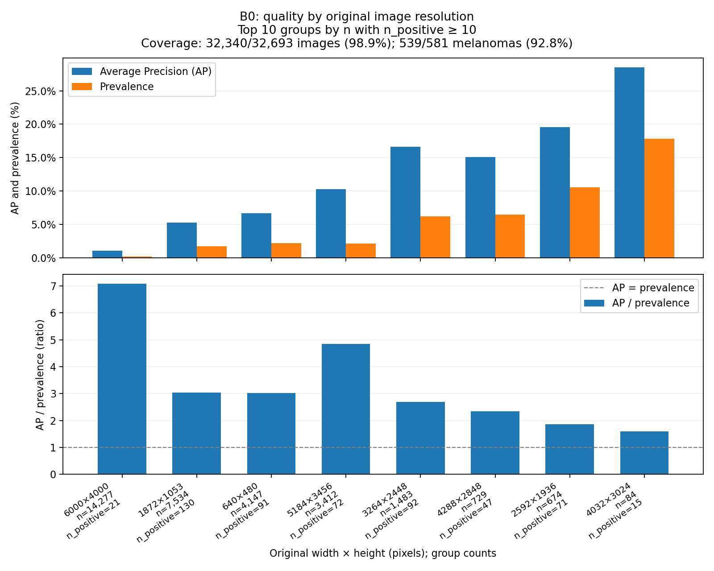
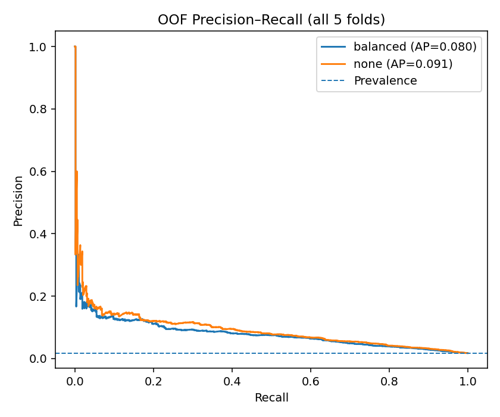
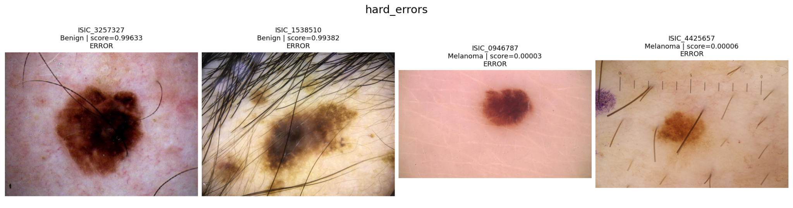
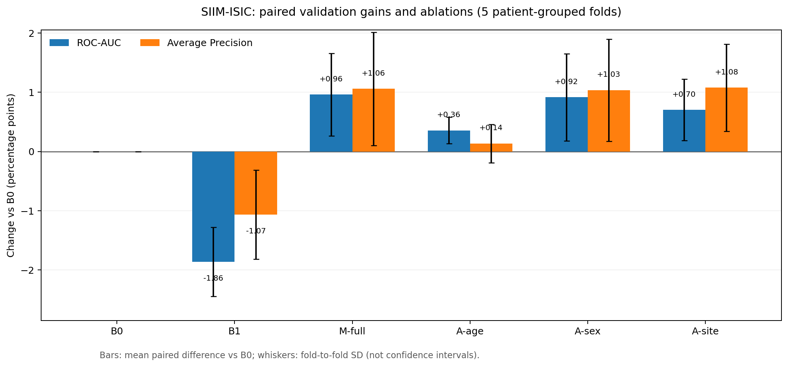
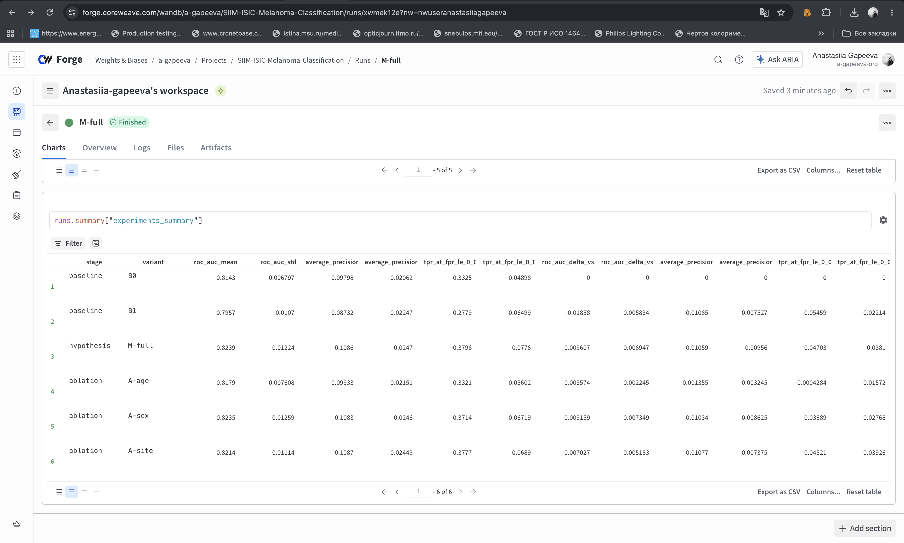

# SIIM-ISIC 2020: классификация меланомы

ДЗ1–ДЗ2 по курсу ML R&D: baseline, улучшение с помощью метаданных, трекинг экспериментов и абляции.

## Задача и данные

**Задача:** бинарная классификация дерматоскопических изображений (`target=1` — меланома, `target=0` — доброкачественное образование). Единица предсказания — изображение; изображения одного пациента не считаются независимыми.

Данные: [SIIM-ISIC 2020 на Kaggle](https://www.kaggle.com/competitions/siim-isic-melanoma-classification/data), исходные `train.csv` и `jpeg/train/*.jpg`, без внешних датасетов.

**EDA (`src.eda`):** 33 126 изображений, 2 056 пациентов, 584 меланомы (1,76%). Найдены 433 пары побайтово одинаковых JPEG (SHA-256); по одному повтору из каждой пары исключено. После очистки — **32 693 изображения, 581 меланома (1,78%)**. Пропуски: возраст — 68, пол — 65, локализация — 527. `diagnosis` и `benign_malignant` не используются как признаки из-за риска утечки целевой информации.

В EDA проверены баланс классов, пропуски, дубликаты, распределение пациентов и характеристики исходных JPEG (размеры, яркость, контраст, доля тёмных пикселей). Доля меланом различается по разрешениям: **0,16%** для 6000×4000 и **10,53%** для 2592×1936 (до очистки). Возможная причина — различия между источниками съёмки; по EDA причинность не устанавливается.



На графике по сохранённым OOF-предсказаниям B0 показаны **Average Precision (AP)**, доля меланом (*prevalence*) и их отношение по группам разрешений. AP зависит от prevalence, поэтому сравнивать её между группами без базового уровня некорректно. При малом числе положительных примеров оценки нестабильны; разрешение — лишь косвенный признак условий съёмки.

## Структура репозитория

```text
SIIM-ISIC-Melanoma-Classification/
├── README.md
├── requirements.txt
├── .gitignore
├── LICENSE
├── configs/
│   ├── baseline.yaml
│   └── kaggle.yaml
├── src/
│   ├── __init__.py
│   ├── common.py
│   ├── eda.py
│   ├── train.py
│   ├── evaluate.py
│   └── pipeline.py
├── reports/
│   └── figures/
│       ├── hard_errors.png
│       ├── roc_oof.png
│       ├── pr_oof.png
│       ├── resolution_analysis.png
│       ├── experiment_comparison.png
│       └── wandb_tracking.png
└── tests/
    ├── __init__.py
    └── test_pipeline.py
```

Генерируемые таблицы, embeddings, модели и OOF-предсказания не хранятся в Git; скрипты формируют их при запуске. В репозитории остаются код, конфиги и итоговые иллюстрации.

## ДЗ1. Baseline и протокол оценки

**Гипотеза:** признаки замороженной ResNet-18 (ImageNet) позволяют отличать меланому от доброкачественных образований с помощью логистической регрессии.

- **Признаки:** 512-мерные embeddings ResNet-18 (`eval()`, без fine-tuning); resize короткой стороны до 256 → center crop 224×224 → нормализация ImageNet. Без аугментаций.
- **Классификатор:** `StandardScaler → LogisticRegression` (`C=1`, `solver=liblinear`). B0 — без взвешивания, B1 — `class_weight=balanced`.
- **Валидация:** пять фолдов `StratifiedGroupKFold`, `seed=42`, группировка по `patient_id`. Нет пересечения пациентов между обучением и валидацией. Используется очищенный CSV и одинаковые фолды во всех вариантах.
- **Метрики:** ROC-AUC (основная), AP и Recall при FPR ≤5%. Результаты — среднее ± выборочное стандартное отклонение по фолдам (`ddof=1`).

ResNet заморожена, поэтому embeddings можно извлечь один раз до CV. Масштабирование и логистическая регрессия обучаются **только на train соответствующего фолда**. Порог для Recall при FPR ≤5% определяется по validation ROC-кривой: это описательная оценка ранжирования, не независимая проверка заранее выбранного порога. Scores не проходили калибровку и не являются подтверждёнными клиническими вероятностями.

| Вариант | ROC-AUC, mean ± std | AP, mean ± std | Recall @ FPR≤5% |
|---|---:|---:|---:|
| **B0 — image-only** | **0,8143 ± 0,0068** | **0,0980 ± 0,0206** | **33,3%** |
| B1 — balanced | 0,7957 ± 0,0107 | 0,0873 ± 0,0225 | 27,8% |

Гипотеза о полезности предобученных признаков подтверждается на CV: ROC-AUC выше 0,5, AP выше prevalence (1,78%). Взвешивание ухудшило обе метрики на всех пяти фолдах. Возможная причина — повышенное влияние сложных или шумных положительных примеров; отдельно она не проверялась.




Метрики на ROC/PR-кривых рассчитаны по **объединённым OOF-предсказаниям**, поэтому отличаются от средних метрик по пяти фолдам в таблице.

**Анализ ошибок:** два доброкачественных образования получили scores выше 0,99 (FP), две меланомы — ниже 0,0001 (FN). На отдельных изображениях видны волосы и измерительные шкалы, но их влияние на ошибки экспериментально не установлено.



## ДЗ2. Метаданные, трекинг и абляции

**Гипотеза:** возраст, пол и локализация образования содержат дополнительную информацию о риске меланомы сверх визуальных признаков; их добавление повысит ROC-AUC/AP относительно B0. Возраст и локализация мотивированы различиями prevalence, обнаруженными в EDA.

Проверены шесть конфигураций. Во всех, кроме B1, `class_weight=None`, остальные параметры классификатора и фолды совпадают с B0.

| Вариант | Изменение относительно B0 / M-full | Назначение |
|---|---|---|
| **B0** | Только изображения | Опорный baseline |
| B1 | Взвешивание классов, без метаданных | Контрольный эксперимент ДЗ1 |
| **M-full** | + возраст, пол, локализация | Проверка гипотезы ДЗ2 |
| **A-age** | M-full без возраста | Абляция возраста |
| **A-sex** | M-full без пола | Абляция пола |
| **A-site** | M-full без локализации | Абляция локализации |

Возраст заполняется медианой **train fold** и стандартизуется. Пропуски пола и локализации кодируются отдельной категорией, остальные значения — через one-hot encoding. Все параметры преобразований определяются только на train fold; на validation применяются без переобучения. `patient_id`, `diagnosis` и `benign_malignant` в модель не подаются. Embeddings и назначения фолдов одинаковы для всех вариантов.

### Результаты экспериментов

Реальный запуск на **32 693 изображениях**, 5 patient-disjoint фолдов; для ROC-AUC и AP приведены mean ± std.

| Конфигурация | ROC-AUC | AP | Recall @ FPR≤5% | Δ ROC-AUC к B0 | Δ AP к B0 |
|---|---:|---:|---:|---:|---:|
| B0 | 0,8143 ± 0,0068 | 0,0980 ± 0,0206 | 33,3% | — | — |
| B1 | 0,7957 ± 0,0107 | 0,0873 ± 0,0225 | 27,8% | −0,0186 | −0,0107 |
| **M-full** | **0,8239 ± 0,0122** | **0,1086 ± 0,0247** | **38,0%** | **+0,0096** | **+0,0106** |
| A-age | 0,8179 ± 0,0076 | 0,0993 ± 0,0215 | 33,2% | +0,0036 | +0,0014 |
| A-sex | 0,8235 ± 0,0126 | 0,1083 ± 0,0246 | 37,1% | +0,0092 | +0,0103 |
| A-site | 0,8214 ± 0,0111 | 0,1087 ± 0,0245 | 37,8% | +0,0070 | +0,0107 |



**Эффект основной гипотезы:** M-full улучшает B0 на **0,0096 ROC-AUC**, **0,0106 AP** и **4,7 п.п. Recall @ FPR≤5%**. AP выросла на пяти фолдах, ROC-AUC — на четырёх. На графике показаны попарные разности метрик для одинаковых фолдов и их разброс, а не доверительные интервалы.

**Выводы абляций (сравнение с M-full):**

- **Без возраста:** ROC-AUC ниже на 0,0060, AP — на 0,0092. Возраст внёс основной дополнительный вклад.
- **Без пола:** ROC-AUC ниже на 0,0004, AP — на 0,0002. Заметного дополнительного вклада пола не обнаружено.
- **Без локализации:** ROC-AUC ниже на 0,0026, AP выше на 0,0002. Влияние небольшое и зависит от метрики.

**Итог:** добавление метаданных улучшило валидационное качество; главный источник прироста — возраст. Небольшие изменения могут быть шумом из-за ограниченного числа меланом и различий между фолдами. Внешняя валидация отсутствует; возможны смещения по источникам съёмки и составу пациентов.

### История экспериментов: W&B

**[Результаты в W&B (CoreWeave Forge)](https://forge.coreweave.com/wandb/a-gapeeva/SIIM-ISIC-Melanoma-Classification)** — конфигурации B0, B1, M-full и трёх абляций, метрики по фолдам, mean/std, разности относительно B0 и визуализации.



Один W&B run на вариант (пять фолдов внутри), все runs в группе `metadata_experiment`. Фиксируются гипотеза, список признаков, конфиг, seed, параметры модели и метрики. Управление через секцию `wandb` YAML (`enabled`, `project`, `entity`, `mode`, `group`); ключ через `WANDB_API_KEY` или `wandb login`, **не в репозитории**. При `enabled: false` пайплайн работает без W&B.

## Воспроизводимость и запуск

Из корня репозитория установить зависимости:

```bash
pip install -r requirements.txt
```

**Локально** поместить исходные CSV и JPEG по путям из `configs/baseline.yaml`. В **Kaggle** подключить конкурсный датасет через *Add Input*, использовать `configs/kaggle.yaml` и GPU для извлечения признаков.

```bash
# Полный запуск: EDA → фолды → embeddings → B0/B1/M-full/абляции → оценка → W&B
python -m src.pipeline --config configs/kaggle.yaml

# Только выбранные модели
python -m src.pipeline --config configs/kaggle.yaml --variants B0 M-full A-age A-sex A-site

# Отдельные этапы
python -m src.pipeline --config configs/kaggle.yaml --stage prepare
python -m src.pipeline --config configs/kaggle.yaml --stage train --variants B0 M-full
python -m src.pipeline --config configs/kaggle.yaml --stage evaluate
```

Для локального запуска заменить `configs/kaggle.yaml` на `configs/baseline.yaml`. Исходные скрипты остаются доступны отдельно:

```bash
python -m src.eda --config configs/kaggle.yaml
python -m src.train --config configs/kaggle.yaml
python -m src.evaluate --config configs/kaggle.yaml
# Только построить/проверить фолды:
python -m src.train --config configs/kaggle.yaml --only-folds
```

Скрипт сортирует данные по `image_name`, создаёт/проверяет 5 фолдов с `seed=42` и переиспользует совместимый кэш embeddings (`data.embeddings_cache`) для всех вариантов. Масштабирование и импутация каждый раз обучаются только на соответствующей train-части. Совместимость кэша и сохранённых фолдов проверяется; несовпадения не игнорируются. Для пересоздания кэша предусмотрен `--recompute-embeddings`.

**Сохраняемые артефакты** (пути настраиваются в YAML):

| Файл | Содержание |
|---|---|
| `splits/folds.csv` | Назначения фолдов для всех изображений |
| `outputs/baseline/embeddings.npz` | Кэш исходных признаков |
| `outputs/experiments/oof_predictions.csv` | OOF-предсказания с указанием варианта |
| `outputs/experiments/protocol.json` | Конфигурация и контроль совместимости результатов |
| `reports/experiments/fold_metrics.csv` | Метрики и разности к B0 по фолдам |
| `reports/experiments/summary.csv` | Средние, std и разности метрик |
| `reports/figures/` | ROC/PR, анализ разрешений, ошибки, сравнение экспериментов |

Все большие выходные файлы генерируются вне Git. Результаты можно повторить на той же выборке, с теми же фолдами и параметрами; независимое тестирование не проводилось. В конкурсном `test.csv` нет меток, leaderboard не использовался для подбора. Протокол не гарантирует переносимость на другие клиники и клиническую применимость.

## Дальнейшая работа и источники

Следующие гипотезы: частичный fine-tuning ResNet-18 и простые аугментации при обучении (отражения, умеренные изменения яркости и контраста) при неизменных validation folds.

Источник: SIIM-ISIC 2020 ([описание датасета](https://doi.org/10.34970/2020-ds01), CC BY-NC 4.0); `torchvision`, `scikit-learn`. Код разработан с помощью ChatGPT; готовые Kaggle notebooks не копировались.
