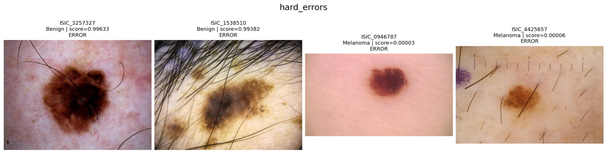

# SIIM-ISIC 2020: классификация меланомы

ДЗ1 по курсу ML R&D: постановка задачи, baseline и воспроизводимая валидация.

## Задача и гипотеза

**Задача:** по дерматоскопическому изображению оценить вероятность меланомы (`target=1`, доброкачественное образование — `0`). Это бинарная классификация. Один объект и одно предсказание — одно изображение. На этапе inference baseline использует **только RGB-изображение**; несколько изображений одного пациента нельзя считать независимыми.

**Гипотеза:** признаки замороженной ResNet-18, предобученной на ImageNet, позволяют отличать меланому от доброкачественных образований с помощью логистической регрессии. Ожидаем ROC-AUC > 0,5 и Average Precision выше доли положительного класса на валидации с непересекающимися пациентами. Это проверка переносимости признаков, **не** клинической пригодности модели.

## Структура репозитория

```text
SIIM-ISIC-Melanoma-Classification/
├── README.md
├── requirements.txt
├── .gitignore
├── LICENSE
├── configs/
│   ├── baseline.yaml
│   └── kaggle.yaml
├── src/
│   ├── __init__.py
│   ├── common.py
│   ├── eda.py
│   ├── train.py
│   └── evaluate.py
├── reports/
│   └── figures/
│       └── hard_errors.png
└── tests/
    ├── __init__.py
    └── test_pipeline.py
```

## Данные и EDA

Источник: [соревнование SIIM-ISIC на Kaggle](https://www.kaggle.com/competitions/siim-isic-melanoma-classification/data), [описание датасета](https://doi.org/10.34970/2020-ds01). Используются только конкурсные `train.csv` и `jpeg/train/*.jpg`.

`src/eda.py` проверяет:

- уникальность `image_name`, наличие файлов, количество изображений на пациента, баланс классов и пропуски;
- доступные метаданные: `age_approx`, `sex`, `anatom_site_general_challenge`, `diagnosis`, `benign_malignant`, включая долю меланом по категориям;
- **точные побайтовые дубликаты** JPEG по SHA-256;
- яркость (среднее в grayscale шкале 0–255), контраст (стандартное отклонение в grayscale шкале 0–255) и долю тёмных пикселей (яркость < 32 по шкале 0–255) **исходных** JPEG. Преобразования изображений в EDA не применяются.

EDA сохраняет `clean_train.csv` и `excluded_images.csv`. Среди идентичных JPEG одного пациента с одинаковой меткой оставляет один; при разных пациентах или метках исключает всю группу (исходные файлы не удаляются). Хэши в отчёт не записываются. Также сохраняются таблицы и графики в `reports/eda/`. `lesion_id` и внешние метаданные не используются. `diagnosis` и `benign_malignant` рассматриваются только при анализе разметки: **в модель они не подаются**.

### Результаты EDA

| Показатель | Значение |
|---|---:|
| Исходные изображения / пациенты | 33 126 / 2 056 |
| Меланомы до очистки | 584 (1,76%) |
| Пациенты с ≥1 меланомой | 428 (20,8%) |
| Точные дубликаты | 433 пары (866 файлов) |
| Исключено повторов | 433, из них 3 положительных |
| После очистки | 32 693 изображения, 581 меланома; 2 056 пациентов |
| Отсутствующие JPEG / JPEG без записи в CSV | 0 / 0 |

Во всех 433 парах точных дубликатов совпадают `patient_id` и `target`; оставлен один файл из каждой пары. В одной паре указаны разные локализации одного и того же изображения (`upper extremity` и `torso`) — пример несогласованности метаданных, не влияющий на image-only baseline.

Пропуски: `sex` — 65, `age_approx` — 68, `anatom_site_general_challenge` — 527. У 27 124 изображений `diagnosis=unknown`; `diagnosis` и `benign_malignant` не используются как признаки из-за риска утечки целевой информации. Медиана числа изображений на пациента — 12, максимум — 115.

Медианы характеристик **исходных** изображений (доброкачественные / меланома): яркость — **177,1 / 148,6**, контраст — **20,9 / 29,0** (шкала grayscale 0–255); доля тёмных пикселей — **0,004% / 0,204%**. Доля меланом также заметно отличается между разрешениями: 6000×4000 — **0,16%** (24 из 14 703), 2592×1936 — **10,53%** (71 из 674). Это может указывать на смещение, связанное с источником или условиями съёмки. Влияет ли оно на предсказания модели, по результатам EDA определить нельзя.

Ограничения: сильный дисбаланс, пропуски метаданных, возможный шум разметки, различия в условиях съёмки. Доля меланом в датасете не равна распространённости заболевания в популяции. Числовые статистики изображений рассчитаны до удаления дублей; baseline обучается на очищенной от дублей выборке.

## Baseline и протокол оценки

- **Признаки:** замороженная `ResNet-18` с весами ImageNet, вектор из 512 признаков. Preprocessing: resize короткой стороны до 256 → центральный crop 224×224 → нормализация ImageNet. Без аугментаций.
- **Классификатор:** `StandardScaler` + `LogisticRegression`. Гиперпараметры (`C`, `solver`, `l1_ratio` (0 = L2), `max_iter`, `tol`, `class_weights`) заданы в YAML-конфиге; `random_state` берётся из `validation.seed`. Параметры `StandardScaler` рассчитываются только на обучающей части каждого фолда; там же обучается `LogisticRegression`.
- **Валидация:** 5-fold `StratifiedGroupKFold`, `seed=42`, группировка по `patient_id`. Используется очищенный CSV из EDA; пересечения пациентов не допускаются.
- **Дисбаланс:** два варианта на одинаковых признаках и фолдах — **B0:** `class_weight=None` (основной baseline), **B1:** `class_weight="balanced"` (контрольный эксперимент).
- **Основная метрика:** ROC-AUC (как в соревновании); дополнительные — Average Precision (AP), Recall при FPR ≤5%, prevalence (доля положительного класса), матрица ошибок при пороге 0,5. Отчёт: значения по фолдам, среднее ± выборочное стандартное отклонение (`ddof=1`), общие OOF-метрики и ROC/PR-кривые. Std описывает разброс между фолдами, а не доверительный интервал.

**Контроль утечек:** embeddings всех изображений вычисляются один раз *до* кросс-валидации. Это допустимо: ResNet-18 заморожена, работает в `eval()` с фиксированными ImageNet-статистиками, а preprocessing детерминирован и не обучается на наших данных. Извлечение признаков каждого изображения не зависит от других изображений и их меток. `StandardScaler` и Logistic Regression, напротив, обучаются **отдельно внутри train-части каждого фолда**; `patient_id` не пересекаются между train и validation. При fine-tuning backbone или подборе статистик по всему датасету такой порядок уже был бы утечкой.

Recall при FPR ≤5% рассчитывается по ROC-кривой validation fold: порог выбирается на этих же данных, поэтому результат не является независимой оценкой заранее выбранного порога. Значения score не проверялись на калибровку и не должны трактоваться как точные вероятности заболевания.

Для будущего сравнения моделей используем средний ROC-AUC на **тех же пяти фолдах**. B0 остаётся опорным вариантом, B1 оцениваем отдельно. Порог 0,5 приведён только для анализа ошибок: он не оптимизирован для применения в клинике.

**Тестирование:** в конкурсном `test.csv` отсутствует `target`, поэтому вычислить метрики на нём локально нельзя. Отправку предсказаний на Kaggle leaderboard не использовали, чтобы не подбирать решения по тесту. Оценка ДЗ1 основана на пятифолдовой валидации с разделением по пациентам; независимого тестирования на внешней выборке не проводилось.

## Запуск

```bash
pip install -r requirements.txt
```

Локальные пути заданы в `configs/baseline.yaml`. В **Kaggle** подключить данные соревнования через **Add Input** и использовать `configs/kaggle.yaml`. Код остаётся тем же и запускается как Python-скрипты:

```bash
python -m src.eda --config configs/kaggle.yaml
python -m src.train --config configs/kaggle.yaml
python -m src.evaluate --config configs/kaggle.yaml
```

Сначала запускается EDA: он создаёт `clean_train.csv`. Разбиение создаёт `train.py` при обучении. При необходимости можно сформировать и проверить фолды отдельно, без извлечения признаков и обучения модели:

```bash
python -m src.train --config configs/kaggle.yaml --only-folds
```

Фолды создаются с помощью StratifiedGroupKFold (n_splits=5, seed=42). Перед разбиением данные сортируются по image_name, поэтому при одинаковом датасете и версиях библиотек разбиение воспроизводится. Сформированные фолды сохраняются локально в splits/folds.csv.

## Результаты

Пятифолдовая кросс-валидация по пациентам на 32 693 изображениях (581 меланома). Среднее ± выборочное std по фолдам:

| Вариант | ROC-AUC | AP | Recall при FPR ≤5% |
|---|---:|---:|---:|
| **B0: без взвешивания** | **0,8143 ± 0,0068** | **0,0980 ± 0,0206** | **33,3%** |
| B1: `class_weight=balanced` | 0,7957 ± 0,0107 | 0,0873 ± 0,0225 | 27,8% |

Гипотеза о полезности замороженных признаков ImageNet подтверждается: ROC-AUC выше 0,5, AP выше доли меланом (1,78%). Взвешивание классов ухудшило ROC-AUC и AP на всех пяти фолдах. Возможное объяснение: большой вес редких положительных примеров меняет границу решения и порядок ранжирования, в том числе усиливая влияние сложных или шумно размеченных изображений. Это предположение, а не установленная причина; само по себе взвешивание не гарантирует улучшения ROC-AUC или AP. В режиме FPR ≤5% модель B0 обнаруживает в среднем лишь около трети меланом.

**Примеры ошибок B0.** Доброкачественные `ISIC_3257327` и `ISIC_1538510` получили scores 0,9963 и 0,9938 (FP); меланомы `ISIC_0946787` и `ISIC_4425657` — 0,000025 и 0,000058 (FN). На некоторых изображениях заметны волосы и измерительные шкалы, но без дополнительных экспериментов нельзя установить, что именно они вызвали ошибки.



Ограничения baseline: замороженные признаки ImageNet, сильный дисбаланс классов, центральное кадрирование, возможные смещения датасета, отсутствие внешней валидации.

## Следующие исследовательские вопросы

1. Дают ли возраст, пол и локализация образования прирост ROC-AUC/AP **сверх визуальных признаков**? Сравнить image-only и image+metadata на тех же фолдах; пропуски обрабатывать только по train.
2. Улучшает ли частичное дообучение ResNet-18 ROC-AUC/AP по сравнению с замороженной моделью? Насколько устойчив прирост по фолдам?
3. Улучшают ли простые аугментации (отражения, умеренные изменения яркости и контраста) ROC-AUC/AP при дообучении ResNet-18? Сравнить обучение с аугментациями и без них на одинаковых фолдах, не применяя аугментации к validation.

## Воспроизводимость и источники

Код EDA, обучения и оценки написан для проекта на основе стандартных API `torchvision` и `scikit-learn`, с помощью ChatGPT; готовые Kaggle notebooks не копировались. Данные — SIIM-ISIC 2020 (CC BY-NC 4.0), предобученные веса — `torchvision` / ImageNet. Конфигурация и сформированные разбиения должны быть зафиксированы в репозитории; численные результаты приводятся только после настоящего запуска.
